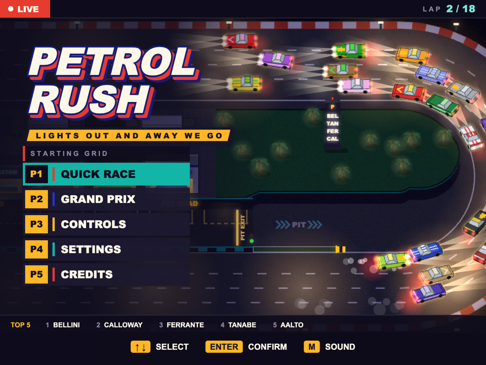
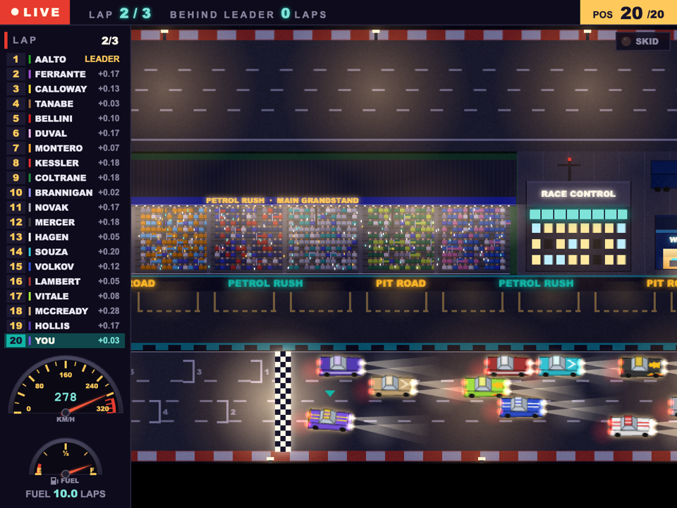
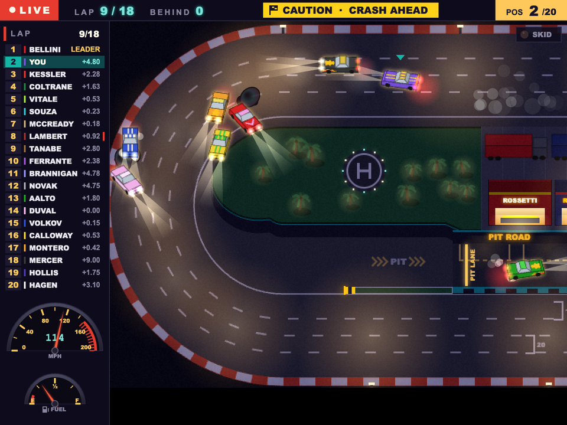

<div align="center">

# 🏁 PETROL RUSH

**An old-school arcade night race under floodlights – 20 cars, a five-round Grand Prix, fuel strategy, pit stops and crashes that matter.**

### [▶ Play in your browser](https://luke-moonweb.github.io/Petrol-Rush/)




</div>

Petrol Rush is a top-down 2D racing game written in TypeScript with plain Canvas 2D and Web Audio.
You race up to 19 AI drivers on a four-lane night oval or in a five-round **Grand Prix** on five more
circuits, manage fuel, dive into the pit lane and try to stay out of the pile-ups. **Every pixel and every sound is generated in code at start-up** – there
are no image, audio or font files in the project.

## ✨ Highlights

- 🏎️ **20-car races** with F1-style grid, five-light start and live timing tower with sector gaps.
- 🏆 **Grand Prix** – a five-round championship on five new circuits, each with its own shape and
  scenery: a harbour triangle, a desert heart with a hairpin dip, an L-shaped street circuit with a
  chicane, twisty forest esses and a grand finale. F1 points (25-18-15-12-10-8-6-4-2-1), standings
  after every round, progress saved in the browser. Every circuit is also available in QUICK RACE.
- ⛽ **Fuel & pit stops** – a full tank lasts about 12 laps. Cross the yellow PIT LANE line and the
  game drives you to your box, refuels and takes you back out.
- 💥 **Crashes that matter** – hit someone in the rear and *they* spin; spinning cars spill
  oil slicks; the culprit gets a **+2 s time penalty**.
- 🛢️ **Oil on track** – any car that drives into a slick spins. AI drivers avoid oil even more than
  each other (but react with a human-like delay).
- 🚦 **Smart, beatable AI** – lane changes, overtaking, avoiding wrecks, staggered pit stops.
- 📻 **Radio spotter** – "Caution! Crash ahead!" through the browser's speech synthesis with a
  radio squelch, plus a yellow-flag banner in the HUD.
- 🔊 **Four engine sounds** to choose from: V8 MUSCLE, JET TURBINE, 8-BIT ARCADE and RC TOY, with
  stereo panning and Doppler for passing rivals.
- 🎥 **Cockpit view** – press C (or CAM on touch screens) to drive from the driver's seat: flat-shaded
  pseudo-3D night track, rivals with working tail and brake lights, a live rear-view mirror and a
  steering wheel that follows your inputs.
- 📺 **Live-on-air title screen** – a silent 20-car demo race plays behind the menu, filmed like a
  TV broadcast.
- ⌨️ **Fully rebindable keys** (primary + alternate per action), saved in the browser.
- 📱 **Touch controls on phones and tablets** – on-screen steering, pedals and menu buttons appear
  automatically; menu items can also be tapped directly.

<table>
  <tr>
    <td></td>
    <td></td>
  </tr>
  <tr>
    <td align="center"><sub>Packed night oval – live tower, fuel on the edge, one bad corner from disaster</sub></td>
    <td align="center"><sub>Crash ahead – caution flag, oil slicks, penalties</sub></td>
  </tr>
</table>

## 🚀 Quick start

Requires [Node.js](https://nodejs.org/) 22.12+, 24, or 26+. The version used by CI is pinned in `.nvmrc`
(`nvm use` picks it up).

```bash
npm install
npm run dev
```

Open the address printed by Vite (by default http://localhost:5173).

| Command | What it does |
|---|---|
| `npm run dev` | Dev server with hot reload |
| `npm run build` | Type-check and production build into `dist/` |
| `npm run preview` | Serve the production build locally |
| `npm test` | Fast tests (~5 s, skips the full-race simulations) |
| `npm run test:all` | Every test, including full-race simulations (~20 s; CI runs this) |
| `npm run typecheck` | TypeScript check only |
| `npm run lint` | Lint and check formatting (Biome) |
| `npm run lint:fix` | Apply safe lint fixes and format the code |

The production build is a static site – `dist/` can be hosted on any static hosting.

## 🎮 Controls

| Key | Action | Alternate |
|---|---|---|
| ← / → | Steer | |
| ↑ | Throttle | W |
| Space | Brake | |
| ↓ | Hold: brake, then reverse once almost stopped; release to leave reverse | S |
| C | Camera: top-down ↔ cockpit | |
| P | Pause | |
| Tab | Race menu (Esc always works) | |
| F1 | Controls & tips | H |
| M | Sound on/off | |
| F | Scaling: fit window ↔ integer scale | |

All driving keys can be changed in **SETTINGS → KEYS**. Arrows, Enter and Esc always navigate menus.

Menus also work with the **mouse**: hovering highlights an item, clicking chooses it, and clicking the
left or right half of a setting row changes its value down or up.

### 📱 Touch screens

On a phone or tablet (detected via `(hover: none) and (pointer: coarse)`) the game shows on-screen
controls next to the picture in landscape, or under it in portrait. Nothing covers the race view.

| Where | Race | Menus |
|---|---|---|
| Left thumb | ◀ ▶ steer – slide between them without lifting | ▲ ▼ ◀ ▶ pad (hold to repeat) |
| Right thumb | BRAKE · GAS – slide between them | BACK · OK |
| Small buttons | REV (reverse), CAM (camera), pause, race menu, sound, fullscreen* | sound, fullscreen* |

Menu items, setting rows and buttons can also be tapped directly on the game screen; tapping the left
or right half of a setting row changes its value down or up. *Fullscreen is hidden where the
browser does not support it (iPhone Safari).

## 🏆 How to race

- **Corner speed depends on the radius.** The tyres have a fixed amount of grip: a tight corner or
  the inside lane needs less speed than a wide one (the centre of the oval goes at about 160 mph,
  the outside lane at about 174). A held steering key asks for about all the grip there is, so you
  can drive right at the limit. A little too fast and the car runs wide and scrubs speed; keep
  steering into a corner you are clearly too fast for and the tail steps out – steer against it (a
  quick tap is enough for a small slide) or it spins. A slide costs more time than braking would
  have. Braking or lifting off in the corner uses grip too: the nose tucks in and the tail gets
  lighter.
- **Warnings:** the red zone on the speedometer shows the limit
  speed of the next corner; the **SKID** lamp lights only when the car really slides, blinks faster
  the more it slides and stays lit through a spin. The cockpit LED strip shows the start lights,
  then how close you are to top speed (one LED per 5 mph from 140, all lit at 180).
- **Hold the throttle to keep your speed** – release it and the car slowly coasts down, like
  lifting off the pedal. Braking is stronger at high speed.
- **Overtake on the straights.** Steering builds up while you hold a key: tap for small corrections,
  hold for a full turn.
- **The car ahead has right of way.** If you run into a car in front of you – even one that just
  changed lanes – the crash is your fault and costs you **+2 s**. The timing tower shows track
  order; penalised cars get a red `+2s` tag, and if you are penalised the top bar shows your
  projected position, e.g. `PEN +2s → P6`. Penalties count in the final classification.
- **Walls:** a glancing contact costs some speed and you slide along the barrier; a steeper hit
  kicks the nose away, and a hard one spins the car – back out with reverse and straighten up.
- **Pit when the fuel gauge gets low.** On the oval, take the funnel at the bottom-left, follow the PIT
  arrows, and the pit crew does the rest. On the Grand Prix circuits the pit lane runs alongside the
  main straight: keep left out of the last corner and take the entry road at the start of the straight.

## ⚙️ Settings

| Option | Choices |
|---|---|
| Engine sound | V8 MUSCLE · JET TURBINE · 8-BIT ARCADE · RC TOY |
| Crash penalties | On / Off |
| Collisions | **Realistic** – the car hit in the rear or rear side spins, the hitter does not · **Classic** – in a hard crash both cars spin |
| Race | Track, number of cars (up to 20), laps (1–100), your car colour, starting position (last / middle / pole / random) |

Settings, key bindings and the Grand Prix in progress are stored in `localStorage`.

## 🏆 Grand Prix

Pick the number of cars, laps per race, your colour and starting position, then race the calendar:

| Round | Circuit | Shape |
|---|---|---|
| 1 | HARBOUR LOOP | Clockwise triangle: a long straight and three sweepers |
| 2 | DESERT HEART | Anticlockwise, with a right-hand hairpin dipping into the infield |
| 3 | NEON CITY | Clockwise L-shaped street circuit with a chicane |
| 4 | PINE FOREST | Anticlockwise, esses and a winding back section |
| 5 | GRAND FINALE | Clockwise: a kink, a chicane, a switchback and a double right |

- Points go to the top ten; penalties count, ties are broken by count-back (more wins, then more
  2nd places …).
- AI drivers keep their pace for the whole season and line up by the standings; you start from the
  grid position you chose.
- When you cross the line, the rest of the field finishes in the background. **RETIRE** in the race
  menu ends your race with a DNF (no points). Restarting a race is allowed (and counted).
- The championship is saved after every round – **CONTINUE** from the Grand Prix screen after a reload.

## 🔗 URL parameters

Handy for testing and tuning:

| Parameter | Effect |
|---|---|
| `?quick` | Skip the menus and start a race |
| `?cars=20&laps=3` | Race options |
| `?seed=123` | Repeatable race |
| `?track=harbour` | Track for `?quick` and QUICK RACE: `oval`, `harbour`, `desert`, `city`, `forest`, `finale` |
| `?debug` | Debug overlay, `]` speeds up time ×4/×8, `window.__game` and `window.__race` in the console, `__ff(seconds)` fast-forwards the game at once |
| `?overlay=URL` | Semi-transparent 640×480 image over the screen for layout comparison |
| `?touch` / `?touch=0` | Force touch controls on / off, regardless of the device |

## 🧱 How it's built

- **Fixed 60 Hz simulation** with interpolated rendering; logical resolution 640×480, scaled to the
  window and drawn at device resolution, so text stays sharp and pixel art stays crisp.
- **Track in Frenet coordinates** (`s` along the lap, `d` across it) – lane keeping, lap counting,
  sectors and AI all work in that space. The oval is analytic; the Grand Prix circuits are polygons with
  a corner radius at every vertex, compiled into straights and arcs (`src/track/segment.ts`), so a loop
  closes by construction and `pointAt`/`project` stay exact.
- **2D camera** – the oval only scrolls sideways; the circuits scroll both ways, leading along the track.
- **Cars are pre-rendered** from tiny 3D models into 32 rotation sprites per livery at start-up.
- **Procedural audio** – engines, tyres, crashes, radio and UI sounds are synthesised with Web Audio.
- **Tunable** – almost every gameplay constant (grip, braking, slide thresholds, AI, collisions,
  penalties, oil, fuel range) lives in `src/config.ts`.

```
src/
  main.ts          game loop (fixed 60 Hz step), scaling
  config.ts        tuning constants and race options
  meta.ts          author and repository links
  input.ts         keyboard, rebindable keys, virtual (touch) actions
  touch.ts         phone detection, on-screen controls and their layout
  prefs.ts         SETTINGS → GAME options
  states/          title (with demo race), Grand Prix screen, controls, settings, credits
    race/          race screen: flow, sound, race-only drawing
  track/           Track interface, oval geometry and pit road, segment circuits, GP calendar,
                   straight pit lane and the pit-lane AI shared by both
  race/            cars, physics & collisions, AI, oil, pit stops, race logic & classification,
                   Grand Prix championship (points, standings, save)
  ui/              HUD, race overlays, text, palette
    menus/         title, controls, settings and credits screens
  gfx/             3D-to-sprite renderer, liveries, particles, world drawing
    fpv/           cockpit view: tiny Canvas 2D polygon renderer, 3D night scene, mirror, dashboard (oval only)
    track/         pre-rendered tracks: oval/ (tarmac, pit road, paddock, infield), circuit/ (themes)
  audio/           Web Audio effects and four engine voices
docs/screenshots/  images used in this README
tests/             Vitest: oval golden master, track geometry, lap counting, physics, collisions,
                   penalties, oil, pit autopilot, championship logic and full headless 20-car
                   races on every circuit
```

## 🧪 Tests

```bash
npm test          # fast tier, ~5 s
npm run test:all  # everything, ~20 s – run before pushing
```

The suite includes headless simulations of complete 20-car races on every circuit (including all
cars pitting on the same lap) to make sure every AI driver finishes without getting stuck or leaving
the track, a whole headless Grand Prix season, and a golden-master test that fingerprints oval races
bit for bit, so refactors cannot change how the oval drives.

---

<div align="center"><sub>All team and driver names in the paddock are fictional.</sub></div>
